  

<h1 align="center">
  
</h1>

  I'm a passionate developer from Sri Lanka, studying at <b>SLIIT</b>. I build full-stack web apps with the <b>MERN stack</b>, mobile apps with <b>Flutter</b>, and games with <b>Unity</b>. I learn new technologies fast and care about clean, usable software.

  🌐 <b>Portfolio:</b> <a href="https://kavidupurnamal.vercel.app/">kavidupurnamal.vercel.app</a>

  
  
  

 

<h2 align="center">🚀 Featured Projects</h2>

<table>
  <tr>
    <th align="left">Project</th>
    <th align="left">Stack</th>
    <th align="left">Links</th>
  </tr>
  <tr>
    <td><b>🏠 Boodima.lk</b> Boarding rental platform</td>
    <td>MongoDB · Express · React · Node</td>
    <td><a href="https://boodima.lk">Live</a> · <a href="https://github.com/K4V1DU/boodima">Code</a></td>
  </tr>
  <tr>
    <td><b>🏫 SmartCampus</b> Campus asset booking system</td>
    <td>React · Node.js · Spring Boot · MySQL</td>
    <td><a href="https://github.com/K4V1DU/it3030-paf-2026-smart-campus-group50">Code</a></td>
  </tr>
  <tr>
    <td><b>🚗 Roadside Assistance</b> 24/7 towing &amp; breakdown app</td>
    <td>Flutter · Dart · Firebase · Maps API</td>
    <td><a href="https://kavidupurnamal.vercel.app/#work">Portfolio</a></td>
  </tr>
  <tr>
    <td><b>💪 FitFlow</b> Workout &amp; meal plan app</td>
    <td>Flutter · Dart · Firebase · REST APIs</td>
    <td><a href="https://kavidupurnamal.vercel.app/#work">Portfolio</a></td>
  </tr>
  <tr>
    <td><b>🐍 Snakes Multiplayer</b> Arena snake game</td>
    <td>Unity · C#</td>
    <td><a href="https://github.com/K4V1DU/SnakeMultiplayer">Code</a></td>
  </tr>
  <tr>
    <td><b>🍳 Kitchen Chaos</b> Cooking game</td>
    <td>Unity · C# · OOP</td>
    <td><a href="https://github.com/K4V1DU/Kitchenchaos">Code</a></td>
  </tr>
</table>

 

<h2 align="center">🛠️ Languages · Frameworks · Tools</h2>

   
   
  

 

<h2 align="center">📊 GitHub Stats</h2>

  
  

 

<h2 align="center">🐍 Contributions</h2>

  

 

  

